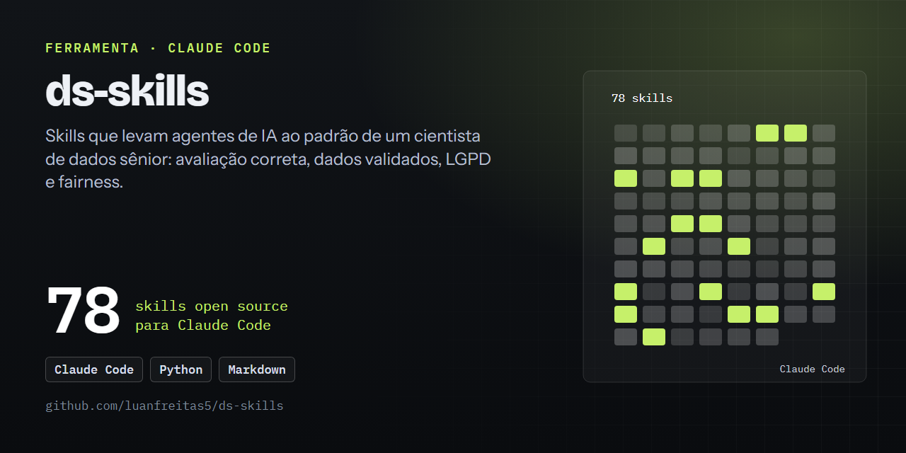

# 🧪 ds-skills — Skills de Ciência de Dados para Claude Code

  

Coleção de skills que levam agentes de IA ao padrão de um cientista de dados sênior: avaliação estatisticamente correta, dados validados, resultados reprodutíveis e IA responsável (LGPD, fairness, documentação).

Cada skill foi escrita usando a skill [superpowers:writing-skills](https://github.com/obra/superpowers/blob/main/skills/writing-skills/SKILL.md) com modelo `Claude Opus 5.5 High`, seguindo TDD para documentação: um cenário de pressão foi executado **sem** a skill (baseline), as falhas observadas guiaram o texto, e o mesmo cenário foi repetido **com** a skill para verificar a mudança de comportamento. Todos os trechos de código foram executados contra dados sintéticos.



## 📦 Skills

| Grupo | Skill | Quando é acionada |
|---|---|---|
| Rigor de modelagem | [`evaluating-models-rigorously`](skills/evaluating-models-rigorously/SKILL.md) | Reportar métricas, comparar modelos, declarar "melhor modelo" |
|  | [`detecting-data-leakage`](skills/detecting-data-leakage/SKILL.md) | Métrica alta demais, snapshot posterior ao rótulo, pré-processamento antes do split |
|  | [`establishing-baselines`](skills/establishing-baselines/SKILL.md) | Início de modelagem, algoritmo "já escolhido", métrica sem referência |
|  | [`tuning-hyperparameters-optuna`](skills/tuning-hyperparameters-optuna/SKILL.md) | Ajuste de hiperparâmetros; melhor score da busca reportado como desempenho |
|  | [`explaining-models-shap`](skills/explaining-models-shap/SKILL.md) | Explicar previsões ou importância de features; features correlacionadas |
|  | [`designing-ab-tests`](skills/designing-ab-tests/SKILL.md) | Planejar ou analisar teste A/B; p-valor olhado todo dia; grupos desbalanceados |
|  | [`evaluating-llm-outputs`](skills/evaluating-llm-outputs/SKILL.md) | Medir qualidade de prompt, agente ou pipeline com LLM; LLM como juiz |
|  | [`building-rag-pipelines`](skills/building-rag-pipelines/SKILL.md) | Construir RAG ou Q&A sobre documentos; escolher chunk, embedding e top-k; avaliar só a resposta final |
|  | [`handling-class-imbalance`](skills/handling-class-imbalance/SKILL.md) | Classe positiva rara (fraude, churn, doença); SMOTE proposto; acurácia ~0,99 em alvo raro; escolha de limiar |
|  | [`backtesting-time-series`](skills/backtesting-time-series/SKILL.md) | Avaliar previsão temporal; KFold com shuffle em série; horizonte ou gap diferentes da produção |
| Dados e reprodutibilidade | [`validating-data-contracts`](skills/validating-data-contracts/SKILL.md) | Funções que leem/limpam/gravam dados entre estágios |
|  | [`ensuring-reproducibility`](skills/ensuring-reproducibility/SKILL.md) | Scripts de treino para artigo, revisão ou deploy |
|  | [`building-point-in-time-features`](skills/building-point-in-time-features/SKILL.md) | Features de tabelas históricas para rótulos com data |
|  | [`writing-analytical-sql`](skills/writing-analytical-sql/SKILL.md) | SQL de análise ou extração de features; JOIN 1:N, `NOT IN`, janelas |
|  | [`writing-idiomatic-polars`](skills/writing-idiomatic-polars/SKILL.md) | Código polars, migração de pandas, dados maiores que a RAM |
|  | [`versioning-data-with-dvc`](skills/versioning-data-with-dvc/SKILL.md) | Versionar dados/modelos; alguém quer commitar `.parquet` ou `.joblib` |
|  | [`configuring-typed-settings`](skills/configuring-typed-settings/SKILL.md) | Configs YAML, argparse, `.env`; hiperparâmetro ou chave nova |
|  | [`ingesting-external-data`](skills/ingesting-external-data/SKILL.md) | Baixar dados de APIs, bancos ou sites para `data/bronze` (Medallion); jobs de coleta agendados |
|  | [`running-structured-eda`](skills/running-structured-eda/SKILL.md) | Primeira exploração de dataset novo (`01_eda.ipynb`); "EDA padrão" de `describe()` e histogramas |
|  | [`optimizing-sql-queries`](skills/optimizing-sql-queries/SKILL.md) | Consulta lenta ou cara no warehouse; antes de criar índice, partição ou clustering |
|  | [`querying-with-duckdb`](skills/querying-with-duckdb/SKILL.md) | Análise local sobre Parquet/CSV grandes; pandas não cabe na memória; DuckDB × polars lazy |
|  | [`profiling-data-pipelines`](skills/profiling-data-pipelines/SKILL.md) | Pipeline lento ou estourando memória, antes de otimizar; "reescrever em polars" ou paralelizar sem medir |
| IA responsável | [`auditing-fairness`](skills/auditing-fairness/SKILL.md) | Modelos que afetam pessoas; atributos sensíveis |
|  | [`writing-model-cards-datasheets`](skills/writing-model-cards-datasheets/SKILL.md) | Documentar modelos e datasets |
|  | [`protecting-pii-lgpd`](skills/protecting-pii-lgpd/SKILL.md) | Dados pessoais em logs, exports, relatórios |
|  | [`monitoring-model-drift`](skills/monitoring-model-drift/SKILL.md) | Modelos em produção; rótulos com atraso |
|  | [`labeling-with-llms`](skills/labeling-with-llms/SKILL.md) | Usar LLM para rotular dados ou gerar dados sintéticos; texto que pode conter dados pessoais |
| MLOps e entrega | [`tracking-experiments-mlflow`](skills/tracking-experiments-mlflow/SKILL.md) | Treinar ou comparar modelos em script de experimento |
|  | [`promoting-models-registry`](skills/promoting-models-registry/SKILL.md) | Registrar modelo ou promover para produção |
|  | [`serving-models-fastapi`](skills/serving-models-fastapi/SKILL.md) | Expor modelo como API |
|  | [`building-streamlit-apps`](skills/building-streamlit-apps/SKILL.md) | Criar ou alterar dashboard Streamlit |
|  | [`plotting-publication-figures`](skills/plotting-publication-figures/SKILL.md) | Gráficos para relatório, artigo ou README |
|  | [`writing-ds-pull-requests`](skills/writing-ds-pull-requests/SKILL.md) | Abrir PR que muda dados, features ou modelo; "métricas depois" |
|  | [`versioning-prompts`](skills/versioning-prompts/SKILL.md) | Prompt em produção muda com frequência; ajuste "de uma linha"; saída sem versão do prompt |
|  | [`containerizing-ml-apps`](skills/containerizing-ml-apps/SKILL.md) | Dockerfile ou docker-compose para app, API ou MLflow; imagem grande, root ou modelo dentro da imagem |
| Engenharia do projeto | [`scaffolding-ds-projects`](skills/scaffolding-ds-projects/SKILL.md) | Novo projeto, `pyproject.toml`, pre-commit, CI |
|  | [`testing-ml-code`](skills/testing-ml-code/SKILL.md) | Testes de transformações e modelos treinados |
|  | [`refactoring-notebooks-to-src`](skills/refactoring-notebooks-to-src/SKILL.md) | Lógica de notebook vira pipeline; "limpar" um notebook |
|  | [`reviewing-ds-code`](skills/reviewing-ds-code/SKILL.md) | Revisar PR ou diff de código de ciência de dados |
|  | [`building-ds-github-actions`](skills/building-ds-github-actions/SKILL.md) | Criar ou corrigir `ci.yml`, `tests.yml`, `docs.yml` |
|  | [`designing-exception-hierarchies`](skills/designing-exception-hierarchies/SKILL.md) | Tratamento de erros em pipelines; `except Exception` genérico; `errors="coerce"` sem limite |
|  | [`writing-numpy-docstrings`](skills/writing-numpy-docstrings/SKILL.md) | Documentar funções públicas; `interrogate` falhando no CI; Examples que não rodam |
|  | [`auditing-python-dependencies`](skills/auditing-python-dependencies/SKILL.md) | Adicionar dependência; CVE no `pip-audit`; revisão periódica de dependências |
|  | [`setting-up-project-logging`](skills/setting-up-project-logging/SKILL.md) | Configurar logging; `print()` para acompanhar execução; logs duplicados ou barra rich quebrada |
|  | [`writing-conventional-commits`](skills/writing-conventional-commits/SKILL.md) | Commitar, preparar release ou gerar CHANGELOG; commit "update" misturando dado, modelo e refatoração |
|  | [`writing-portfolio-readmes`](skills/writing-portfolio-readmes/SKILL.md) | README de portfólio ou de artigo; pedido de "listar as tecnologias", badges, instalação |
|  | [`type-checking-with-basedpyright`](skills/type-checking-with-basedpyright/SKILL.md) | Configurar checagem de tipos; erros de tipo com pandas/polars/numpy; vontade de usar `# type: ignore` ou `Any` |
|  | [`fixing-python-warnings`](skills/fixing-python-warnings/SKILL.md) | `FutureWarning`, `DeprecationWarning`, `RuntimeWarning` ou `ConvergenceWarning` no log/pytest; pedido de "sumir com os warnings"; vontade de usar `filterwarnings("ignore")` ou `np.errstate` |

## 🚀 Instalação

Como plugin (recomendado):

```text
/plugin marketplace add https://github.com/luanfreitas5/ds-skills.git
/plugin install ds-skills@ds-skills-marketplace
```

Ou como skills pessoais: copie as pastas de `skills/` para `~/.claude/skills/`.

## 🗂️ Estrutura

```
ds-skills/
├── .claude-plugin/
│   ├── plugin.json
│   └── marketplace.json
├── skills/
│   └── <skill-name>/
│       ├── SKILL.md          # frontmatter (name, description) + conteúdo
│       └── *_template.*      # templates reutilizáveis, quando aplicável
├── CLAUDE.md                 # padrões de projeto que originaram as skills
├── LICENSE
└── README.md
```

## ✍️ Convenções

- Texto das skills em inglês (melhor descoberta pelo agente); exemplos de código com docstrings NumPy e logs em pt-BR.
- `description` descreve **quando** usar, nunca o passo a passo.
- Referências cruzadas via `REQUIRED SUB-SKILL: <nome>`.

## 📄 Licença

MIT — veja [LICENSE](LICENSE).
